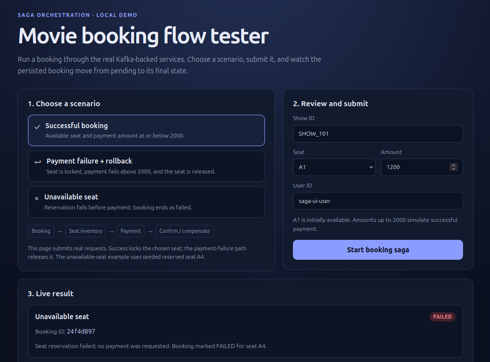

# Movie booking saga

A Java 21 / Spring Boot demo of an orchestrated movie-booking saga. The
`booking-orchestrator` accepts the HTTP request and coordinates the booking,
seat-inventory, and payment services through Kafka. Booking and seat state are
stored in MySQL.

## Project layout

| Module | Responsibility | Port |
| --- | --- | ---: |
| `booking-orchestrator` | HTTP entry point and saga coordinator | 8181 |
| `booking-service` | Creates and updates booking records | 9191 |
| `seat-inventory-service` | Locks and releases seats | 9292 |
| `payment-service` | Simulates payment (amounts over 2000 fail) | 9393 |
| `movie-booking-commons` | Shared event and request types, Kafka topics | — |

The [`docker-compose.yml`](docker-compose.yml) stack runs Kafka, MySQL, and all
four Spring Boot services. The services use Docker's internal network, while
their HTTP ports and Kafka/MySQL development ports are published on the host.

## Request and saga flow

Send a booking request to `POST http://localhost:8181/orchestrator/bookings`.
The controller returns a generated booking ID as plain text as soon as the
orchestrator publishes the initial Kafka messages; this is **not** confirmation
that the booking has completed.

**Successful payment**

1. The orchestrator publishes a `PENDING` booking to `movie-booking-events`
   and a seat reservation command to `seat-reserved-commands`.
2. The booking service persists the pending booking. The seat service checks
   the requested seats and locks them if all are available.
3. The seat service publishes the result on `seat-reserved-topic`. If
   successful, the orchestrator requests payment on
   `payment-events-commands`.
4. The payment service publishes a result on `payment-events`. For an amount
   of 2000 or less, the orchestrator publishes a `CONFIRMED` booking update.

**Compensation paths**

- If any requested seat is unavailable, the orchestrator publishes a `FAILED`
  booking update. No payment is requested.
- If payment fails (amount greater than 2000), the orchestrator sends a seat
  release command. The seat service releases the lock and publishes the
  reservation result; the booking is then updated to `FAILED`.

The Kafka topics are defined in
`movie-booking-commons/src/main/java/com/javatechie/common/KafkaConfigProperties.java`.
Processing is asynchronous, so check the service logs and MySQL after submitting
a request to observe the final state.

## Run the complete stack with Docker Compose

- Docker with the Compose plugin
- Postman (for importing and running the included collection)

From the repository root, build and start the entire stack:

```bash
docker compose up --build -d --wait
docker compose ps
```

Each application has its own `Dockerfile`. Builds use the repository root as
their context so the shared `movie-booking-commons` module is installed into
the image before compiling the application.

Compose waits for Kafka and MySQL health checks before starting the services,
and for the dependent services before marking the orchestrator ready. The seat
service creates its table and loads the sample inventory from `data.sql`;
initialization is idempotent on restarts.

The single-page flow tester is available at `http://localhost:8181/`. Choose a
success, payment-failure/rollback, or unavailable-seat scenario, then click
**Start booking saga**. It submits the request and polls for the final persisted
booking status. The form is editable for trying other show IDs, seats, and
amounts; payment amounts above 2000 simulate failure. The UI and HTTP API are
for local development, not production use. When a preset seat has already been
used, choose another available seat from the form (for example `A5` for another
successful booking). The Postman collection below is an alternative API-level
test.



The orchestrator API is also available at `http://localhost:8181`. Compose also
publishes the service ports `9191`, `9292`, and `9393`, Kafka at
`localhost:9092`, and MySQL at `localhost:3306`. The database is `javatechie`;
the default local-development credentials are `root` / `Password`. Set
`MYSQL_ROOT_PASSWORD` in the environment to override the default. Do not use
the default credentials outside a local development environment.

To follow application startup or troubleshoot:

```bash
docker compose logs -f booking-orchestrator booking-service seat-inventory-service payment-service
```

### Run the applications on the host instead

For iterative Java development, start only Kafka and MySQL with
`docker compose up -d kafka mysql`. With Java 21 and Maven 3.9 or later
installed, run the following from the repository root:

```bash
mvn -f movie-booking-commons/pom.xml install
(cd booking-orchestrator && mvn spring-boot:run)
(cd booking-service && mvn spring-boot:run)
(cd seat-inventory-service && mvn spring-boot:run)
(cd payment-service && mvn spring-boot:run)
```

Run each application command in its own terminal. The host configuration uses
`localhost` for Kafka and MySQL. After the seat-inventory service has created
its table, load the example seats once:

```bash
docker compose exec -T mysql mysql -uroot -pPassword javatechie \
  < seat-inventory-service/src/main/resources/data.sql
```

This seed script is idempotent for the example show/seat combinations.

## Test with Postman

Import [`postman/Movie Booking Saga.postman_collection.json`](postman/Movie%20Booking%20Saga.postman_collection.json)
in Postman if you prefer to call the API directly instead of using the
[single-page flow tester](http://localhost:8181/). The collection targets
`http://localhost:8181` and contains:

| Request | Input | Expected saga outcome |
| --- | --- | --- |
| Successful booking | `SHOW_101`, seat `A1`, amount `1200` | Seats locked; booking eventually `CONFIRMED` |
| Payment failure and seat rollback | `SHOW_101`, seat `A2`, amount `2501` | Payment fails; seat released; booking eventually `FAILED` |
| Seat already reserved | `SHOW_101`, seat `A4`, amount `1000` | No payment; booking eventually `FAILED` |

Run the requests individually after Compose reports the services as healthy.
Each request asserts that the API accepts it and returns a booking ID. The API
response is immediate; allow a few seconds for the Kafka consumers to finish.
Verify the final booking and seat states in MySQL, and use the Compose logs
command above to follow event processing. For example, query the database with:

```bash
docker compose exec mysql mysql -uroot -pPassword javatechie \
  -e "SELECT * FROM Booking; SELECT * FROM seat_inventory WHERE showId = 'SHOW_101';"
```

The status page polls `GET /orchestrator/bookings/{bookingId}`; the orchestrator
reads the booking from the booking service. The success case should show a
confirmed booking and a locked `A1`; the payment failure case should show a
failed booking and `A2` available again. `A4` should remain reserved. Re-running
the success request for `A1` or the payment-failure request for `A2` will no
longer exercise the same path, because each changes that seat's state.

The expected request body uses the shared `BookingRequest` record:

```json
{
  "reservationId": "postman-test",
  "showId": "SHOW_101",
  "seatIds": ["A1"],
  "userId": "postman-user",
  "timestamp": "2026-11-10T09:00:00Z",
  "amount": 1200
}
```

`reservationId` and `timestamp` are part of the accepted request shape but are
not used by the current orchestration flow.

## Run tests

The modules are independent Maven projects. With Java 21 and Maven 3.9 or later
installed, run tests from each application module, for example:

```bash
(cd booking-orchestrator && mvn test)
```

Repeat for `booking-service`, `seat-inventory-service`, and `payment-service`.

## Stop the stack

```bash
docker compose down
```

This stops the containers while preserving their named data volumes. To remove
the local database and Kafka data as well (including bookings and seat state),
use `docker compose down -v`.
